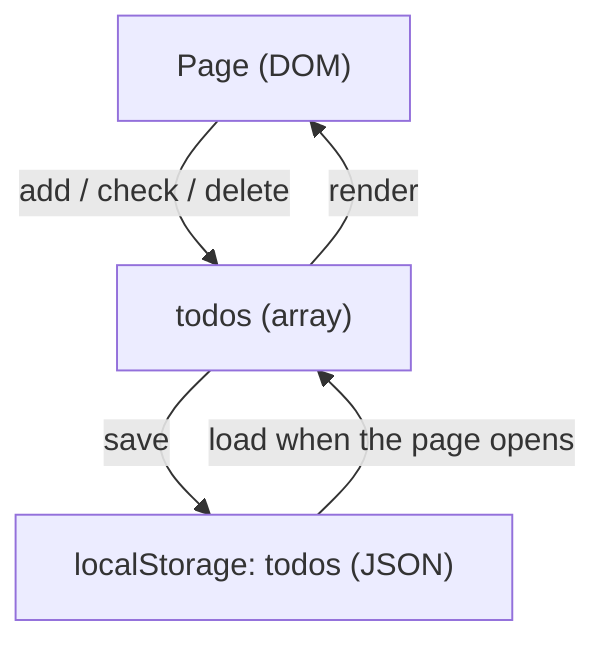

English | [日本語](../ja/todo-app.md)

# ToDo app

`src/todo.ts` is a small ToDo app. The browser tests and the visual regression tests exercise it.

## Behavior

- Type a title and press 追加 (or Enter) to add a task to the end of the list. Spaces around the title are removed, a title of only spaces is ignored, and the same title can be added more than once. The browser itself stops an empty title, because the input is `required`.
- Check a task to mark it done, and uncheck it to make it open again. The line under the list counts the open tasks (`残り N 件`). A done task looks the same apart from its check mark.
- Press 削除 next to a task to delete it. Only that task goes, even when another task has the same title. Focus then moves to the 削除 of the task that took its place, to the one before it when the deleted task was the last, or to the input when the list becomes empty.
- Tasks are saved in `localStorage` under the key `todos`, so they survive a reload. Tasks cannot be renamed or reordered.

## How it works



`src/main.ts` calls `mountTodo(root, localStorage)` when the page opens. Because `mountTodo` takes the storage as an argument, the tests pass a cleared `localStorage` and start from the same state every time. After every change the app saves the whole list and draws it again.

## Run it

Run these commands on the host, not in the development container, which publishes no ports.

```sh
npm run dev       # serve the app at http://localhost:5173/
npm run build     # write the app to dist/
npm run preview   # serve dist/ at http://localhost:4173/
```

- Open `http://localhost:5173/`. The dev server listens on `localhost`, which is `::1` on macOS, so `http://127.0.0.1:5173/` does not connect.
- If port 5173 is taken, the dev server moves to the next free port. Use the `Local:` URL it prints.
- Saving a file updates the open page: CSS in place, TypeScript with a full reload. Tasks survive the reload.
- The dev server and the preview show different tasks, because each port has its own `localStorage`.
- `npm run build` does not check types. Run `npm run typecheck` for that.
