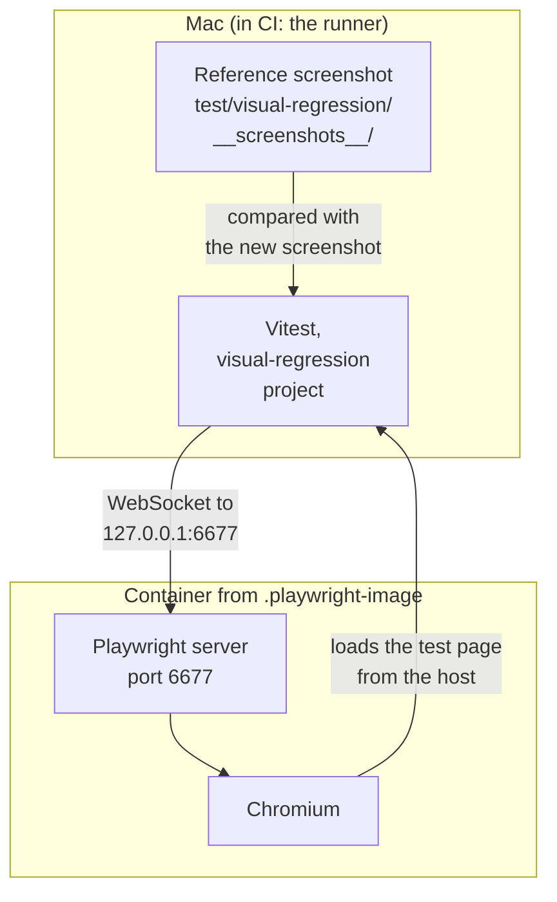

English | [日本語](../ja/visual-regression.md)

# Visual regression tests

## How it works



The browser runs in a container whose image is pinned by tag and digest in `.playwright-image`, so the Mac (Apple Container, arm64) and CI (Docker, amd64) produce the same pixels. Vitest runs on the host and connects to the server; it never falls back to a local browser. Reference file names leave out the platform, so one reference serves both.

`test/visual-regression/todo.test.ts` adds two tasks, checks one, waits for the bundled web font (Noto Sans JP), and compares the `main` element with the reference.

`test/visual-regression/diff-demo.test.ts` shows what failed comparisons look like while the run stays green. It draws a small sample card that is not part of the app and compares it with three references: as it is under `変える前`, where it must match, and with one change under `変えた後` (the button color, the heading moved by 1px, a taller card), where it must not. The `変えた後` tests are marked `test.fails`, so the summary counts them as "expected fail". The last `変えた後` test makes the same 1px move but allows 2 % of the pixels to differ, so it passes.

## Run the tests

These commands start the server with Apple Container. To use Docker instead, as CI does, run `npm run visual-regression:server` and `npm run visual-regression:server:stop` with `CONTAINER_RUNTIME=docker` set, for example `CONTAINER_RUNTIME=docker npm run visual-regression:server`.

```sh
npm run visual-regression:server        # start the Playwright server
npm run test:visual-regression          # compare with the reference screenshots
npm run test:visual-regression:ui       # the same in Vitest UI; press q to quit
npm run test:visual-regression:update   # accept an intended UI change
npm run visual-regression:server:stop
```

- Use `npm run test:visual-regression:update`, not `npm run test:visual-regression --update`. npm keeps `--update` for itself, so Vitest never sees it.
- `npm run test:visual-regression:update` skips the `変えた後` tests. They draw a changed card on purpose, and updating would save it as the reference.
- With the server stopped, the tests fail at once with `connect ECONNREFUSED 127.0.0.1:6677`.

## Review the results

| What | Where | When |
|---|---|---|
| Reference screenshots | `test/visual-regression/__screenshots__/`. In a pull request, GitHub shows a changed image as 2-up, Swipe and Onion Skin. | Always |
| Actual and diff images | `.vitest/attachments/`, and the CI artifact `visual-regression-attachments` | When a comparison fails. The `変えた後` tests fail theirs on purpose, on every run. |
| Vitest UI with the trace view | `npm run test:visual-regression:ui -- --browser.traceView` | While it runs |
| Playwright trace | `npx vitest run --project visual-regression --browser.trace=on`, then `npx playwright show-trace` on the file in `test/visual-regression/__traces__/` | When you ask for it |

- In a diff image, red pixels differ, yellow pixels are anti-aliasing and do not count, and light gray pixels are unchanged.
- When the size changes, there is no diff image, only the actual one.
- The `変えた後` tests write their images to `.vitest/attachments/test/visual-regression/diff-demo.test.ts/` on every run. When the Visual regression job fails, `visual-regression-attachments` contains them too.
- Passing runs do not clear `.vitest/attachments/`. Check the file times before you trust an image there.
- The trace view draws the recorded DOM again in your own browser, so fonts can differ from the screenshots. Judge pixels by the images.
- Git does not ignore `test/visual-regression/__traces__/`.

## Upgrade Playwright

Update `playwright` in `package.json` and the tag and digest in `.playwright-image` in the same commit. Then run `npm install`, `npm run visual-regression:server:stop` and `npm run visual-regression:server`. `npm run visual-regression:server` refuses to start when the installed `playwright` differs from the version in the image tag, and it keeps using a server that is already running, even an old one.
