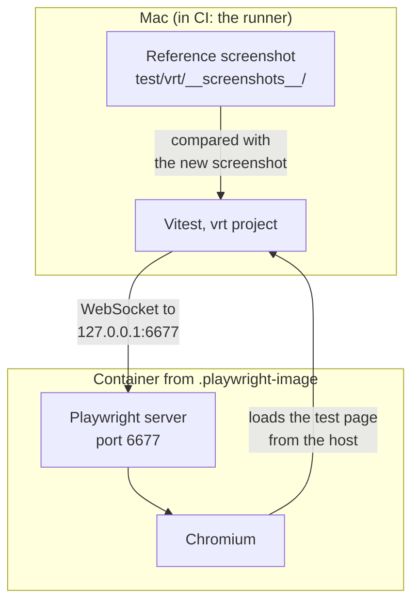

English | [日本語](../ja/visual-regression.md)

# Visual regression tests

## How it works



The browser runs in a container whose image is pinned by tag and digest in `.playwright-image`, so the Mac (Apple Container, arm64) and CI (Docker, amd64) produce the same pixels. Vitest runs on the host and connects to the server; it never falls back to a local browser. Reference file names leave out the platform, so one reference serves both.

`test/vrt/todo.vrt.test.ts` adds two tasks, checks one, waits for the bundled web font (Noto Sans JP), and compares the `main` element with the reference.

## Run the tests

These commands start the server with Apple Container. To use Docker instead, as CI does, run `npm run vrt:server` and `npm run vrt:server:stop` with `CONTAINER_RUNTIME=docker` set, for example `CONTAINER_RUNTIME=docker npm run vrt:server`.

```sh
npm run vrt:server           # start the Playwright server
npm run test:visual          # compare with the reference screenshots
npm run test:visual:update   # accept an intended UI change
npm run vrt:server:stop
```

- Use `npm run test:visual:update`, not `npm run test:visual --update`. npm keeps `--update` for itself, so Vitest never sees it.
- With the server stopped, the tests fail at once with `connect ECONNREFUSED 127.0.0.1:6677`.

## Review the results

| What | Where | When |
|---|---|---|
| Reference screenshots | `test/vrt/__screenshots__/`. In a pull request, GitHub shows a changed image as 2-up, Swipe and Onion Skin. | Always |
| Actual and diff images | `.vitest/attachments/`, and the CI artifact `vrt-attachments` | Only when a comparison fails |
| Vitest UI with the trace view | `npx vitest --project vrt --ui --browser.traceView` | While it runs |
| Playwright trace | `npx vitest run --project vrt --browser.trace=on`, then `npx playwright show-trace` on the file in `test/vrt/__traces__/` | When you ask for it |

- In a diff image, red pixels differ, yellow pixels are anti-aliasing and do not count, and light gray pixels are unchanged.
- When the size changes, there is no diff image, only the actual one.
- Passing runs do not clear `.vitest/attachments/`. Check the file times before you trust an image there.
- The trace view draws the recorded DOM again in your own browser, so fonts can differ from the screenshots. Judge pixels by the images.
- Git does not ignore `test/vrt/__traces__/`.

## Upgrade Playwright

Update `playwright` in `package.json` and the tag and digest in `.playwright-image` in the same commit. Then run `npm install`, `npm run vrt:server:stop` and `npm run vrt:server`. `npm run vrt:server` refuses to start when the installed `playwright` differs from the version in the image tag, and it keeps using a server that is already running, even an old one.
