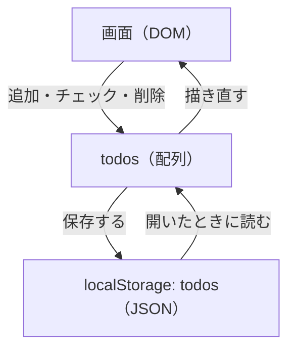

[English](../en/todo-app.md) | 日本語

# ToDo アプリ

`src/todo.ts` は小さな ToDo アプリです。ブラウザーのテストとビジュアルリグレッションテストが、このアプリを操作します。

## 仕様

- 名前を入れて「追加」を押す（または Enter）と、一覧の最後にタスクが加わります。名前の前後の空白は除かれ、空白だけの名前は無視され、同じ名前は何度でも追加できます。空の名前は、入力欄が `required` なので、ブラウザー自身が止めます。
- チェックを入れると完了になり、外すと未完了に戻ります。一覧の下の行が、未完了のタスクの数（`残り N 件`）を示します。完了したタスクも、チェック以外の見た目は変わりません。
- タスクの横の「削除」を押すと、そのタスクが消えます。同じ名前のタスクがあっても、消えるのは押したものだけです。そのあとフォーカスは、繰り上がったタスクの「削除」に移ります。消したのが最後のタスクなら 1 つ前のタスクの「削除」に、一覧が空になったら入力欄に移ります。
- タスクは `localStorage` のキー `todos` に保存されるので、再読み込みしても残ります。名前の変更と並べ替えはできません。

## 仕組み



ページを開くと、`src/main.ts` が `mountTodo(root, localStorage)` を呼びます。`mountTodo` は保存先を引数で受け取るので、テストは空にした `localStorage` を渡して、毎回同じ状態から始められます。アプリは、変更のたびに一覧全体を保存して描き直します。

## 動かす

次のコマンドは、開発用コンテナではなくホストで実行します。コンテナはポートを公開していません。

```sh
npm run dev       # アプリを http://localhost:5173/ で配る
npm run build     # アプリを dist/ に書き出す
npm run preview   # dist/ を http://localhost:4173/ で配る
```

- `http://localhost:5173/` を開いてください。開発サーバーは `localhost` で待ち受け、macOS ではそれが `::1` なので、`http://127.0.0.1:5173/` ではつながりません。
- 5173 番が使われていると、開発サーバーは次に空いている番号へ移ります。表示された `Local:` の URL を使ってください。
- ファイルを保存すると、開いているページに反映されます。CSS はページを開いたまま入れ替わり、TypeScript はページ全体を読み込み直します。読み込み直しても、タスクは残ります。
- 開発サーバーとプレビューでは、ポートごとに `localStorage` が別なので、別々のタスクが出ます。
- `npm run build` は型を検査しません。型は `npm run typecheck` で確かめます。
