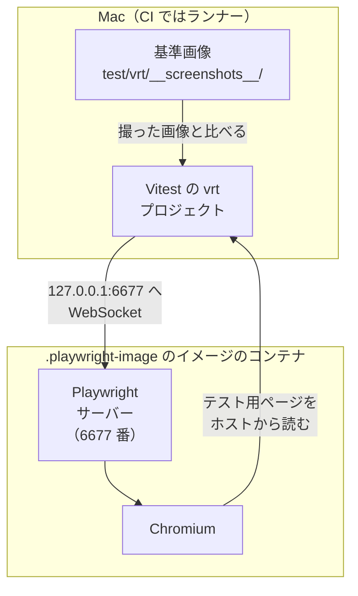

[English](../en/visual-regression.md) | 日本語

# ビジュアルリグレッションテスト

## 仕組み



ブラウザーは、`.playwright-image` にタグとダイジェストで固定したイメージのコンテナで動きます。そのため、Mac（Apple Container、arm64）と CI（Docker、amd64）で同じ画素になります。Vitest はホストで動いてサーバーにつなぎ、手元のブラウザーに切り替わることはありません。基準画像の名前には OS を入れないので、1 枚の基準画像を両方で使えます。

`test/vrt/todo.vrt.test.ts` は、タスクを 2 件追加して 1 件にチェックを入れ、同梱した Web フォント（Noto Sans JP）の読み込みを待ってから、`main` 要素を基準画像と比べます。

## テストを実行する

次のコマンドは、Apple Container でサーバーを起動します。CI と同じく Docker を使うときは、`npm run vrt:server` と `npm run vrt:server:stop` を、`CONTAINER_RUNTIME=docker npm run vrt:server` のように `CONTAINER_RUNTIME=docker` を付けて実行してください。

```sh
npm run vrt:server           # Playwright サーバーを起動する
npm run test:visual          # 基準画像と比べる
npm run test:visual:update   # 意図した見た目の変更を基準画像に反映する
npm run vrt:server:stop
```

- `npm run test:visual --update` ではなく `npm run test:visual:update` を使ってください。`--update` は npm が自分の設定として受け取るので、Vitest に届きません。
- サーバーが止まっていると、テストは `connect ECONNREFUSED 127.0.0.1:6677` ですぐに失敗します。

## 結果を見る

| 見るもの | 場所 | 残るとき |
|---|---|---|
| 基準画像 | `test/vrt/__screenshots__/`。PR では、変わった画像を GitHub が 2-up、Swipe、Onion Skin で見せる | いつでも |
| 実際の画像と差分画像 | `.vitest/attachments/`。CI では成果物 `vrt-attachments` | 比べて違ったときだけ |
| Vitest UI のトレースビュー | `npx vitest --project vrt --ui --browser.traceView` | 動かしているあいだ |
| Playwright のトレース | `npx vitest run --project vrt --browser.trace=on` のあと、`test/vrt/__traces__/` のファイルを `npx playwright show-trace` で開く | 指定したとき |

- 差分画像では、違う画素が赤、アンチエイリアスと判定された画素が黄色（失敗の数に入らない）、同じ画素が薄い灰色になります。
- 大きさが変わったときは差分画像は作られず、実際の画像だけが残ります。
- テストが通っても `.vitest/attachments/` は消えません。そこの画像を見る前に、ファイルの日時を確かめてください。
- トレースビューは、記録した DOM を手元のブラウザーで描き直すので、フォントがスクリーンショットと違うことがあります。画素の正否は画像で判断してください。
- `test/vrt/__traces__/` は git の管理から外していません。

## Playwright を上げる

`package.json` の `playwright` と、`.playwright-image` のタグとダイジェストを、同じコミットで変えます。そのあと、`npm install`、`npm run vrt:server:stop`、`npm run vrt:server` の順に実行します。`npm run vrt:server` は、入っている `playwright` の版がイメージのタグの版と違うと起動しません。また、すでに動いているサーバーがあれば、古いものでもそのまま使います。
